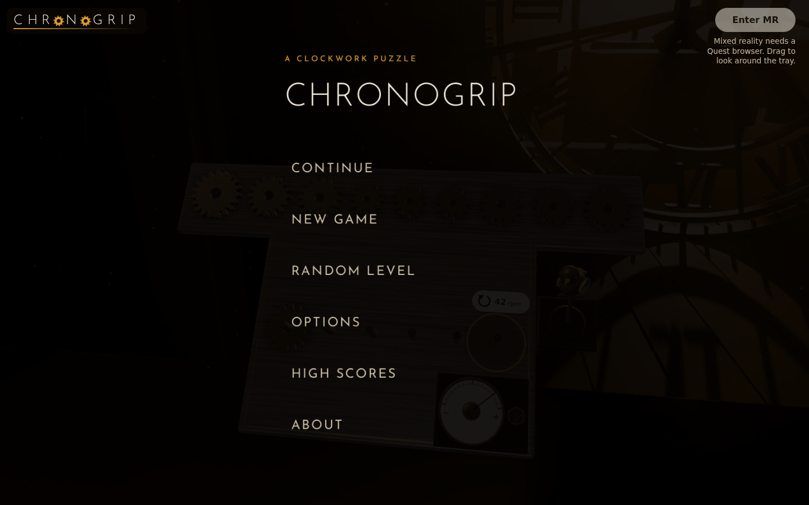
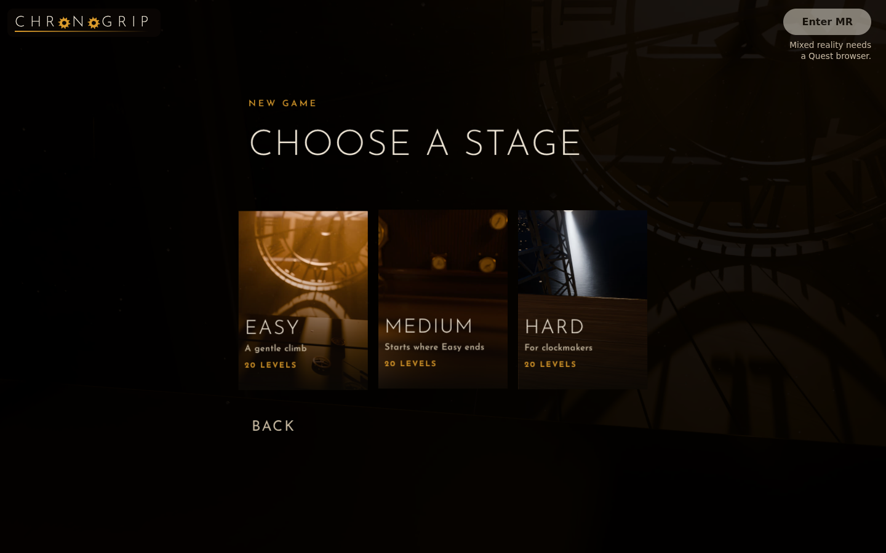
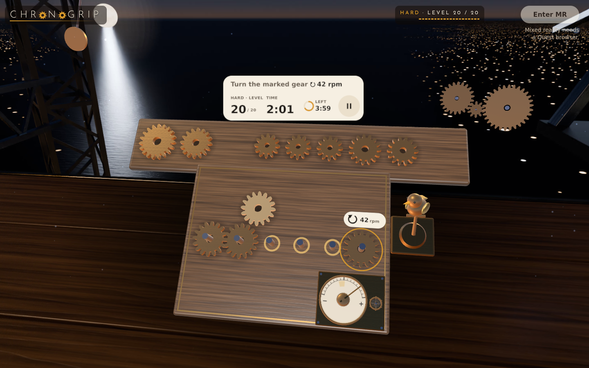
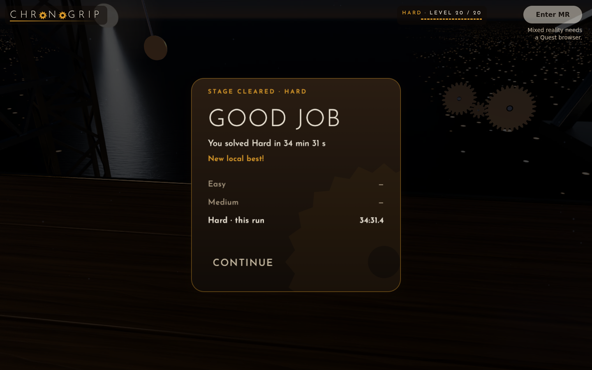

# ChronoGrip MR

A seated mixed-reality clockwork puzzle you play with your bare hands: pinch brass gears onto axles, then roll your wrist to regulate the escapement until a little brass bird comes to life.

**Play it:** https://chrisbuildsonline.github.io/chronogrip-mr/ (open it in the Quest browser and press **Enter MR**; any desktop browser gets a mouse-driven preview).

Built for the [Meta VR Start Developer Competition 2026](https://start-developer-competition-26.devpost.com/). **Track:** Gaming. **Division:** New Experience.

<table>
  <tr>
    <td width="50%" valign="top"><br><sub>The title menu over the attic room. Continue appears once a run is saved.</sub></td>
    <td width="50%" valign="top"><br><sub>New Game: three stages of 20 generated levels, each card showing its room.</sub></td>
  </tr>
  <tr>
    <td width="50%" valign="top"><br><sub>Hard, level 20, at the Iron Tower. Carry a gear and the axles it fits are ringed amber.</sub></td>
    <td width="50%" valign="top"><br><sub>Level 20 cleared: confetti, the bird's song, then your run's time and place.</sub></td>
  </tr>
</table>

*Screenshots from the desktop preview in Chromium at 1440 x 900, driven by the mouse; in a Quest the same tray sits in front of you in passthrough. `bun run screenshots` takes them again. The stage-cleared shot starts from a saved Hard run at level 20.*

## What it is and who it is for

ChronoGrip is a puzzle game for people who are sitting down: on a plane, at a bus stop, on the couch. Everything sits on a 40 x 30 cm walnut tray in front of you, within arm's reach and inside a comfortable view cone (`src/seat.ts`), so you never stand, turn or stretch. In a Quest you see your real surroundings through passthrough and play with your hands.

There are three stages, Easy, Medium and Hard, of 20 levels each. Every level is generated fresh each time you play it, so you can't memorise a stage. Each level has a time limit, and a stage run goes on the high scores.

## Inspiration

Most VR games want you standing in an empty room. A lot of the time you are not: you are in an airplane seat with your forearms on the armrests, or on a bench at a bus stop, with not much space in front of you. We wanted something you could play right there.

A pocket watch felt right. It is small, it sits on your lap, and fixing one is all fingertips and wrists. So ChronoGrip is a pocket-sized clockwork repair: a tray stands on your table or tray table in passthrough, and you fix it with your hands. No controllers, no standing, no turning around.

## How to play

1. **Pick a stage.** On the title menu, **New Game** opens three stage cards: Easy ("A gentle climb"), Medium ("Starts where Easy ends") and Hard ("For clockmakers"). A run starts at level 1 of that stage.
2. **Build the gear train.** Loose gears wait in a strip along the far edge of the tray. Pick one up, carry it and let go over an axle. While you carry it, the axles it fits pulse with an amber ring. Released near a free axle it snaps on with a click; anywhere else it floats back to the strip. Connect the driver to the marked gear so it turns the right way at the right speed. A badge beside the target shows the goal, a turn arrow and the rpm, and the line at the top says it in words ("Turn the marked gear ↻ 90 rpm"). Gears that jam shake and grind; a train that turns the wrong way turns the badge's arrow red.
3. **Regulate the escapement.** When the train is right, the escapement in the near-right corner starts ticking. Turn the regulator dial (clockwise is faster, 1 to 5 ticks a second) and hold the needle in the amber band, within 10% of the target rate, for 0.8 s.
4. **Reward.** The gears flash, the train runs, the brass bird flaps, and the complete card shows your time with **Next**. After level 20 the stage is cleared.

On level 1 a translucent ghost hand shows the first move (pinch, carry, drop) until you grab a gear, then shows the wrist twist beside the dial.

### Time limit, pause and runs

- Each level has a time limit that grows with its difficulty, from 2 minutes on the first Easy levels to 6 minutes on Hard level 20. A ring in the top card counts it down, and the music changes in the last 30 seconds. **No timer** (in Options or on the pause menu) turns the limit off.
- **Pause** hides the board and stops the clock. **Resume** counts down 3, 2, 1 and the board comes back. There is no penalty. The pause menu also has **Restart** (a new puzzle at the same level; the run's clock keeps what you spent), **Give up** and **Main menu** (the run is kept, and **Continue** on the title picks it up). Switching tabs or opening the headset menu pauses too.
- A run ends when you clear level 20, when the time runs out or when you give up. If the run makes the stage's top ten, you enter three letters, arcade style. A run that ends early counts only with at least one level cleared and the timer on; otherwise a short card shows the level you reached and your time.
- The page header shows where you are: the stage, **LEVEL n / 20** and a 20-segment bar.
- **Random level** on the title menu is practice: pick Easy, Medium, Hard or Expert for one generated puzzle, then **Play again** or go back. It keeps no score.

### Controls in a Quest (hands)

| Action | How |
| --- | --- |
| Pick up, carry, drop a gear | Pinch it (thumb and index tip together, within 4 cm), move, open the pinch |
| Press a menu button | Poke it with your index tip, or start a pinch on it. A hand carrying a gear presses nothing |
| Turn the regulator | Pinch the dial and roll your wrist like turning a key (160 degrees end to end) |
| Pause | The round pause button by the level card, or the headset menu |
| Recenter the tray | Pinch with both hands and hold for 1 second (not while carrying a gear) |

A free hand makes a loose gear glow when it comes within 5 cm, and the gear or axle your head points at gets a soft tint. If no hands are tracked, a line above the card reads "Put the controllers down and use your hands".

### Desktop preview (mouse and keys)

The same game runs in any desktop browser with WebGL, and on a phone in portrait (the menus become bottom sheets). Where the browser cannot start an immersive-ar session, **Enter MR** stays disabled with the note "Mixed reality needs a Quest browser."

- **Click** a menu button; **drag** a loose gear onto an axle.
- **Calibrate:** press the dial's knob and drag sideways (right is faster).
- **Drag** empty space to look around the tray, within limits; **scroll** to zoom. **R** or a double-click on empty space puts the view back.
- **Arrows** or **Tab** walk a menu's buttons and **Enter** presses the one picked; on the complete card **Enter** is **Next**. **Esc** pauses, resumes or goes back one menu; **P** pauses and resumes.
- Name entry: type the letters, or use the arrows (up and down change a letter, left and right move between them); **Enter** saves.

## What's in it

- **Title menu.** New Game, Continue (when a run is saved), Random level, Options (No timer, Sound, Music, Reset progress), High scores and About, as light text rows on a dark layer over the scene. While the game loads, two brass gears tick on the dark page.
- **Generated levels.** `src/random.ts` builds each puzzle from a fresh seed: a recipe (how many axles to fill, compound gear pairs, spare decoy gears, near-misses only a tooth or two off, a forced change of direction, how tight the target is) comes from the level's place on a difficulty curve. It builds 40 valid candidates, measures how hard each one is, and keeps the one closest to the level's target. The three curves overlap: Medium starts where Easy ends, and Hard climbs to the hardest puzzle the generator can make.
- **Three rooms.** Each stage plays in front of its own room, a cubemap rendered in Blender: an attic clock window for Easy (also behind the menus), a clockmaker's atelier for Medium and an iron tower over a harbour city at midnight for Hard. Parts of each room move in time with the music: the attic clock's second hand, a big wheel and a pendulum in the atelier, a pendulum across the moon and a gear train on the tower. The stage cards in the picker show the same rooms, floating and slowly panning.
- **Music.** Each stage has its own theme and the menus have a calm one, all composed and played in code with WebAudio (chord progressions, a melody and its answer, pad and bass voices). Themes crossfade as you move between menus and stages. The gear clicks, grinds, ticks and chimes are synthesised too.
- **The table.** A walnut tray with brass and steel parts. On a desktop with a real GPU the metals reflect the stage's room and the tray has a varnished clearcoat. Software GL and headset browsers get a lighter tier (`src/quality.ts`). There is no workbench: a soft shadow sits under the tray.
- **High scores.** One board per stage, kept on this device, ranked by levels cleared and then by total time; the top ten stay. The **Global** tab shows a shared top ten from a public Supabase table. Only the stage, three initials, the levels cleared and the total time are sent. Every score is queued in an outbox, so a post that fails offline is sent again later. When the global board cannot be reached, the local one shows with a short note.
- **Stage cleared.** Clearing level 20 plays a fanfare and the bird's song, throws brass gear confetti over the tray, spins the room's moving parts up, and shows a stage-cleared card with your time, your place on the local board and your best times on the other stages. With reduced motion turned on, there is no confetti and nothing spins.
- **About.** What the game is, how to play and the rules of a run, in a scrolling window.

### Saved on this device

The run in progress (`chronogrip.run.v1`), the high scores (`chronogrip.scores.v1`), the tray's spot in MR (`chronogrip.tray.v1`) and the No timer, Sound and Music switches, all in localStorage. Corrupt or blocked storage starts clean. **Reset progress** forgets the run and keeps the high scores.

## Room data it uses

- **Detected planes only.** The game reads the WebXR plane-detection polygons the headset reports for horizontal surfaces. It does not use MRUK: MRUK is Meta's scene SDK for native Unity and Unreal apps, and this is a WebXR page built on IWSDK, where plane detection is the room data on offer. No camera images, meshes or room scans are read.
- **The tray stands on your table.** For the first 3 seconds after **Enter MR** the game looks for a horizontal surface 25-70 cm below your head, within 70 cm ahead and at least 25 cm across. The tray sits flush with the table edge nearest you, turned to match it, 2 cm inside the edge, with a riser if the table is low. A brass ring pulses out from under the tray when a table places it. The comfort cone always wins: if the table would put a part out of easy reach, the tray stays where it is comfortable, and a small table gets the line "Table's a bit small, tray kept in easy reach". With no usable table the tray takes a default pose 32 cm ahead of and 19 cm below your head, tilted 50 degrees towards you.
- **It is remembered.** The next time you press **Enter MR** the tray comes back to the spot it had; a two-hand recenter moves it and saves the new spot.

## Testing it (for judges)

**On a Quest 3.** Open https://chrisbuildsonline.github.io/chronogrip-mr/ in the Quest browser. Put the controllers down, sit with a table or tray table in front of you and press **Enter MR**. Poke **New Game**, then the **Easy** card. Pinch a gear onto its axle, then pinch the dial and roll your wrist.

**In any desktop browser.** Open the same URL. Enter MR stays disabled, but the whole game runs with the mouse:

- Click **New Game**, then **Easy**, and drag a loose gear from the strip onto a free axle.
- When the escapement starts ticking, press the dial's knob and drag sideways (right is faster) until the needle sits in the amber band.
- Keys: **Enter** presses the picked menu button, or **Next** on the complete card. **Esc** pauses, resumes or goes back one menu.

**Locally with Docker.** No Bun or browsers needed on the host:

```
bun run docker:build             # or: docker build -t chronogrip-mr .
docker run --rm -p 4173:4173 chronogrip-mr
```

Then open http://localhost:4173.

**The test suite.** `bun run check` runs the typecheck, the unit tests and the three Playwright e2e projects (after `bun install`; the e2e run takes about 15-20 minutes on software GL). `bun run docker:test` runs the same inside the image.

## Run, build, test

Needs [Bun](https://bun.sh).

```
bun install
bunx playwright install chromium   # once, for the e2e tests
bun run dev         # dev server with the WebXR emulator (Quest 3) injected
bun run build       # production build into dist/
bun run preview     # serve dist/ on http://localhost:4173
bun run typecheck   # tsc --noEmit
bun run test        # unit tests (Vitest)
bun run e2e         # Playwright, all three projects; starts its own servers
bun run screenshots # retakes the README screenshots in docs/ (not part of e2e)
```

Or in Docker, with no browsers or Node tools on the host: `bun run docker:build`, then `bun run docker:serve` serves the production build at http://localhost:4173 in the background and `bun run docker:stop` stops it.

`bun run e2e` runs three Playwright projects (pick one with `bun run e2e --project=preview`, `--project=dev` or `--project=devmode`):

- **preview**: the production build on port 4173, no emulator, mouse and keys. Loading, the menus, the stage picker, runs, the time limit and pause, generated levels, high scores (with the global backend stubbed), the backdrops and their moving parts, music, the render budget and the phone layout.
- **dev**: the dev server on port 5174 with the IWER emulator posing as a Quest 3. Entering the session, hands, pinch grab and drop (by default a carry starts through IWSDK's `GrabSystem`; add `?grab=pinch` to the URL to force the raw pinch for gears), head gaze and hand glow, two-hand recenter, poking menu buttons, pause from the headset menu, a table placing the tray, the tray coming back after a reload, and the hand occluders.
- **devmode**: a `DEV_MODE=on` build on port 4179, for the cheat panel.

The unit tests cover the gear geometry, the train solver, the level generator and the stage curves, the regulator, tray placement, the flow, runs and scores, the global board and the outbox, the music composer and the quality tiers, with fuzz tests for the gear geometry, the train solver and level parsing.

**Developer cheats.** A build made with `DEV_MODE=on` (in the shell or `.env`) adds a small DEV pill at the bottom left: pick a stage, solve the level on the board, play any level 1-20, or clear the stage to see the celebration. Each cheat runs the game's own flow, and a cheated run never goes to the global board. Without the flag the panel is compiled out of the build.

Deploys: `.github/workflows/deploy.yml` typechecks, runs the unit tests, builds and publishes `dist/` to GitHub Pages on every push to `main`. The build uses relative asset paths, so it works under `/chronogrip-mr/`.

## How we built it

ChronoGrip is a web app: TypeScript, IWSDK (`@iwsdk/core`, the Immersive Web SDK) for the WebXR `immersive-ar` session, three.js for rendering and Vite for the build. It runs in the Quest browser with nothing to install.

- **Hands.** IWSDK's `GrabSystem` picks up and carries the gears: while a level is in play in XR, each loose gear is a one-hand grabbable. Every frame `mr.ts` also reads the thumb tip, index tip and wrist joints from the XR frame: tips closer than 2 cm are a pinch, the pinch point and index tip press buttons, the wrist's roll turns the regulator, and two pinching hands recenter the tray. If IWSDK has not grabbed a pinched gear within 4 frames, the raw pinch picks it up. The IWSDK grab path is tested in the IWER emulator only, not yet on a real headset.
- **Passthrough.** Your real hands hide the tray and gears behind them: `occlude.ts` puts depth-only spheres and capsules on the 25 hand joints, drawn before the board (an approximation of the hand's shape, so the edges are rough). The tray's spot is remembered between sessions: saved in localStorage relative to your head (`persist.ts`) and, where the browser offers WebXR persistent anchors, also pinned to the room with one (tested in the IWER emulator only, not yet on a Quest).
- **Gears and solver.** `gear.ts` draws involute tooth outlines in code and extrudes them. `train.ts` walks the meshed gears, works out each speed and direction, and reports a jam when a loop disagrees or gears collide.
- **Levels.** `random.ts` generates and scores every puzzle; `stages.ts` is the one table of stages, difficulty curves, time limits, rooms and themes.
- **Rooms.** Blender scenes made from scratch in Python (`art/backdrops/`), rendered as six 2048 px cube faces (1024 px on a phone). `ambient.ts` adds the moving parts, placed on spots measured from the renders and driven by the music's beat clock.
- **Sound.** `music.ts` composes, `voices.ts` and `sound.ts` play it with WebAudio oscillators, noise and a convolution reverb. No audio files.

### Code map

| Module | Does |
| --- | --- |
| `main.ts` | Wires everything: input, flow, runs, scores, per-frame update, test hooks |
| `config.ts`, `enter.ts` | The immersive-ar session options; Enter MR |
| `mr.ts`, `anchor.ts`, `edge.ts` | Hand joints (pinch, poke, wrist), plane search, tray placement and edge snap, two-hand recenter |
| `persist.ts`, `keeper.ts` | The tray's saved spot, and the room pin where the browser has one |
| `occlude.ts`, `cue.ts` | Depth-only hand occluders; the "table found" ring |
| `seat.ts`, `fit.ts` | Seated layout and comfort cone; desktop and phone camera framing |
| `gear.ts`, `train.ts` | Involute gear meshes; the gear-train solver |
| `stages.ts`, `random.ts`, `tinker.ts`, `levels.ts`, `seed.ts` | Stages and curves; the generator; puzzle building blocks; the level format and checker (plus hand-made levels the tests use); puzzle seeds |
| `run.ts`, `timer.ts`, `flow.ts` | A stage run; time limits; the game's states |
| `scores.ts`, `global.ts`, `outbox.ts` | Local boards and name entry; the global board; resending scores |
| `grab.ts`, `hover.ts`, `ghost.ts` | Pick and snap rules, `?grab=pinch`; gaze, glow and axle hints; the ghost hand |
| `escapement.ts`, `clockwork.ts`, `goal.ts`, `badge.ts`, `fault.ts` | The regulator; dial, balance wheel and bird; the goal and its badge; jam and wrong-way cues |
| `ui.ts`, `panels.ts`, `cards.ts`, `motion.ts` | Menu layouts and hits; canvas-drawn menus and cards; the stage cards and their motion |
| `scene.ts`, `scenery.ts`, `wood.ts`, `metal.ts`, `quality.ts` | The tray and its parts; room, shadow and table props; walnut and metal materials; quality tiers |
| `backdrop.ts`, `ambient.ts`, `celebrate.ts` | Cubemap loading; the rooms' moving parts; stage-cleared confetti and spin-up |
| `music.ts`, `voices.ts`, `sound.ts` | Composer, instruments, audio engine |
| `cheats.ts` | The `DEV_MODE=on` cheat panel |
| `palette.ts`, `render.ts`, `budget.ts`, `tween.ts` | Colours; software-GL tuning; render budget; easing |

**Render budget:** at most 100 draw calls and 60,000 triangles a frame while playing; an e2e test checks it on generated levels.

## Challenges

- **No pinch point to read.** IWSDK's grab system turns a pinch into a generic grab, but it does not give us the pinch point, the index tip for pokes or the wrist's roll. So IWSDK grabs the gears, and we read the joints ourselves for buttons, the regulator dial, recentering and a fallback when IWSDK misses a pinched gear.
- **Levels you can't learn.** A random puzzle can be trivial or unsolvable. The generator builds many candidates, rejects any that fail the solver or the comfort cone, measures the rest and keeps the one nearest the target, so difficulty climbs steadily inside each stage.
- **Testing hands without a headset.** The IWER emulator has hands, but a test has to set each hand's pinch value and move it step by step. Shared helpers for pinch, carry and poke let the whole story run headless, end to end.
- **Slow software GL.** Test machines have no GPU, and the full look stalled a first frame for 40 seconds. A lighter quality tier, fewer parallel workers and longer timeouts keep the e2e run reliable.
- **Seated comfort.** Every gear, axle, dial and menu button has to stay inside a comfortable view cone and within arm's reach; `seat.ts` defines the cone and unit tests check the parts against it.
- **Two copies of three.js.** IWSDK brought its own three.js, and two copies break `instanceof` checks between them. Vite's `resolve.dedupe` keeps one.

## What's next

Target launch date: January 2027, free in the Quest browser at the live URL.

- Test hand occlusion, the remembered tray spot and IWSDK's gear grab on a Quest 3; so far they are checked in the emulator only.
- Profile on a Quest 3. Frame rate on a headset is unmeasured: the render budget is measured in software GL only.

## How it fits the judging

- **Innovation & Creativity:** a hands-only clockwork repair built for seated passthrough. Turning the regulator is a real wrist roll, like winding a key, and no two runs see the same puzzles.
- **Experience Design:** nothing asks you to stand, turn or stretch, and tests keep every part inside a comfort cone. Level 1 teaches by a ghost hand. Pause hides the board and costs nothing.
- **Technical Implementation:** joint-level hand input, plane-based tray placement, involute gear geometry, a gear-train solver with jam detection and a generate-and-score level generator, covered by unit, fuzz and emulated-headset e2e tests.
- **Polish & Presentation:** three rendered rooms that move with their music, music composed in code, a stage-cleared celebration and global high scores. One live URL, one Docker command.

## Credits and license

MIT, see LICENSE. Made by Chris.

The rooms (cubemaps and stage-card art) and the walnut textures are rendered in Blender from our own scripts in `art/backdrops/`, with no third-party assets. Apart from those, the only images are the README screenshots in `docs/`, taken from the game by `bun run screenshots`. The gears, metals and menus are drawn in code, and the music and sounds are synthesised with WebAudio: the game ships no model or audio files. The menu font is Josefin Sans (SIL Open Font License), self-hosted. Third-party code: IWSDK and three.js, and for development Vite, TypeScript, Vitest and Playwright.
